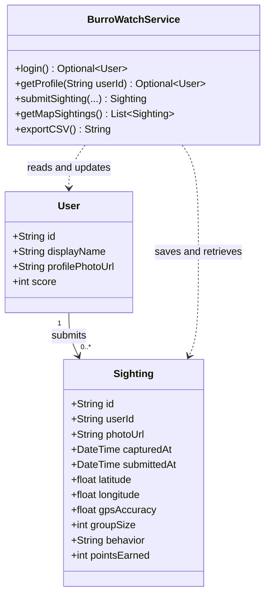

# BurroWatch UCR

Cutie Hack 2026 Streamlit app for reporting wild burro sightings at UC Riverside.
Signed-in students capture an in-app photo with GPS, group size, and behavior;
sightings show on a live map and can be exported as CSV for research.

**Repo:** https://github.com/oscar-e-ruiz/CutieHack2026

## Features

- **Google sign-in** (`st.login`) — creates a Supabase `users` row on first login
- **Home** — profile photo, name, safety note, in-app camera, GPS, group size / behavior form, submit, logout
- **Sightings Map** — past 7 days of sightings, coordinates rounded to ~100 m, refreshes every 10 seconds
- **Export** — researcher CSV with exact coordinates; users identified by Google `sub` only (no names/emails)
- **Leaderboard** — top 10 users by `score` from the `users` table
- **Profile** — photo, name, score, sign out

## Stack

| Need | Choice |
|---|---|
| UI | Streamlit, Python 3.12 (uv) |
| Packages | `streamlit[auth]`, `supabase`, `streamlit-js-eval` |
| Auth | Google via `st.login()`; `st.user.sub` → `User.id` |
| Data | Supabase Postgres (`users`, `Sightings`) + public Storage bucket `photos` |
| Camera | `st.camera_input` on Home |
| GPS | `get_geolocation()` from streamlit-js-eval |
| Map / CSV | `st.map` / `st.download_button` |

**Rule:** pages draw UI and call `BurroWatchService` where possible; `service.py` owns Supabase access.

## Run locally

```bash
uv sync
uv run streamlit run src/streamlit_app.py
```

- Run from the **repo root** so Streamlit finds `.streamlit/secrets.toml`
- Keep the app on port **8501** so it matches the Google OAuth redirect URI

## Secrets

`.streamlit/secrets.toml` is gitignored — never commit it. Local template:

```toml
[auth]
redirect_uri = "http://localhost:8501/oauth2callback"
cookie_secret = "<LONG_RANDOM_STRING>"
client_id = "<GOOGLE_CLIENT_ID>"
client_secret = "<GOOGLE_CLIENT_SECRET>"
server_metadata_url = "https://accounts.google.com/.well-known/openid-configuration"

[supabase]
url = "https://<PROJECT_REF>.supabase.co"
secret_key = "sb_secret_<...>"
```

On Streamlit Community Cloud, paste the same secrets and set:

`redirect_uri = "https://<your-app>.streamlit.app/oauth2callback"`

Add that URI to the Google OAuth client's Authorized redirect URIs (keep localhost too).

## Supabase setup

**`users` table**

| Column | Type |
|---|---|
| `id` | text PK (Google `sub`) |
| `display_name` | text |
| `profile_photo_url` | text (nullable) |
| `score` | int4, default 0 |

**`Sightings` table** (capital S)

| Column | Type |
|---|---|
| `id` | uuid, default `gen_random_uuid()` |
| `user_id` | **text** (must match `users.id`; not uuid) |
| `photo_url` | text |
| `captured_at` | timestamptz |
| `submitted_at` | timestamptz, default `now()` |
| `latitude`, `longitude`, `gps_accuracy` | float8 |
| `group_size` | int4 |
| `behavior` | text |
| `points_earned` | int4, default 0 |

**Storage:** public bucket named exactly `photos`.

## Project layout

```text
src/
  streamlit_app.py     # Google auth gate + st.navigation
  service.py           # BurroWatchService (Supabase)
  models.py            # User, Sighting dataclasses
  app_pages/
    home.py            # capture + submit flow
    live_map.py        # map of recent sightings
    export.py          # CSV download
    leaderboard.py     # top scores
    profile.py         # profile + sign out
    report.py          # leftover camera page; real capture is on Home
```

## Service API

| Method | Status |
|---|---|
| `login()` / `get_profile()` | Done |
| `submit_sighting()` | Done — uploads JPEG to `photos`, inserts `Sightings` (`points_earned` = 0) |
| `get_map_sightings(days=7)` | Done — rounds lat/lon to 3 decimals for the public map |
| `export_csv()` | Done — exact coords; returns `None` if empty |
| `get_leaderboard()` | Not in service yet; leaderboard page queries `users` directly |
| `get_sighting_history()` | Not built |

## Deploy

1. On [share.streamlit.io](https://share.streamlit.io): New app → `oscar-e-ruiz/CutieHack2026`, branch `main`, file `src/streamlit_app.py`
2. Paste secrets; update Google redirect URI for the Cloud URL
3. Open the app in Safari/Chrome (not in-app browsers — Google blocks those with `disallowed_useragent`)
4. Phone camera and GPS need **HTTPS** (deployed app) or localhost

## Notes / known gotchas

- Submit requires a location; denied GPS blocks save
- Same photo cannot be double-submitted (hash guard on Home)
- `Sightings.user_id` must be **text**, or Google `sub` inserts fail with `22P02`
- Missing `photos` bucket → `Bucket not found` on submit
- Points / daily caps were scoped out for the hackathon; scores may stay at 0 unless updated elsewhere
- Community Cloud sleeps after idle time; free Supabase can pause — wake both before judging

## Class diagram


